# Tekenable Advance Related List — User Guide

Tekenable Advance Related List shows a record's related records, for example an Account's Opportunities, on the record page. You can search, filter, sort and page through the whole list, and use the buttons your administrator has added.

- [Part 1 — Using the list](#part-1--using-the-list)
- [Part 2 — Setting up a list (administrators)](#part-2--setting-up-a-list-administrators)
- [Questions](#questions)

---

## Part 1 — Using the list

### The list on a record page

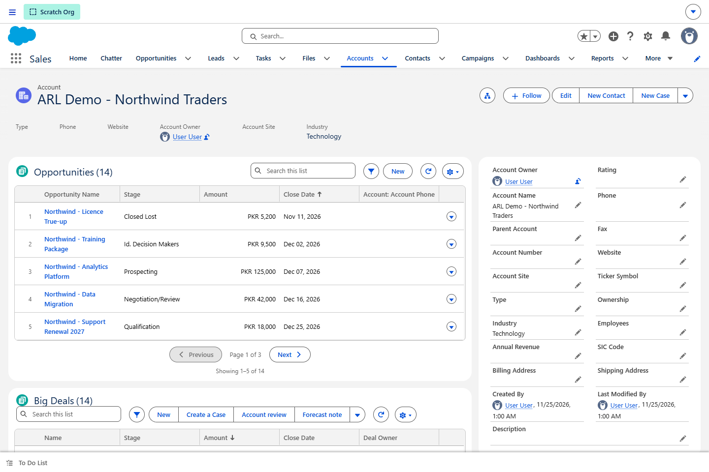

The title shows the list name and how many records it has. Below it are the search box, the filter button, the list's buttons, **Refresh** (↻) and **Settings** (⚙).

### Search

Type in **Search this list**. The list updates as you type and searches the fields your administrator chose, such as the name.

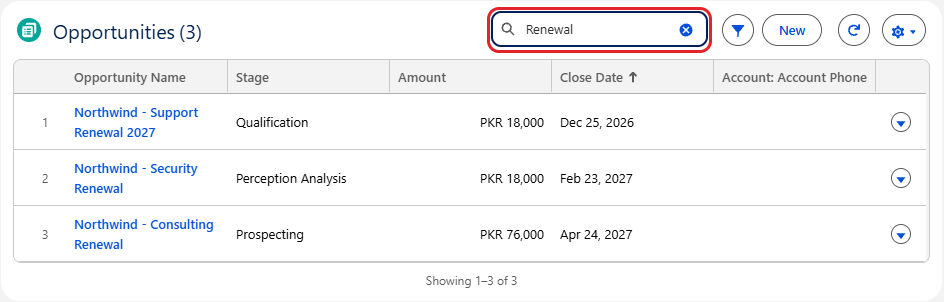

### Filter

1. Click the **filter** button (funnel icon).
2. Choose a field, a condition (for example *equals*, *contains*, *is after*) and a value. Dates use a date picker, and fields with set values, such as Stage, use a dropdown.
3. Click **Add condition** for more filters, and choose **All conditions (AND)** or **Any condition (OR)**.
4. Click **Apply**.

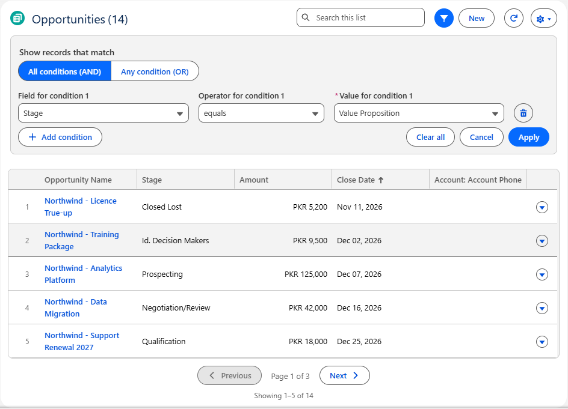

The active filters appear above the list. Click **×** on one to remove it, or **Clear all** to remove them all.

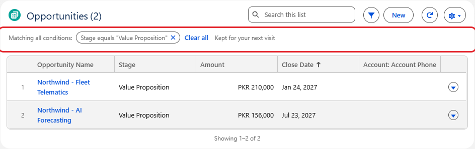

**Your filters are kept.** When you refresh the page or open another record with the same list, your filters and sort are still applied, and the list shows *Kept for your next visit*. They are saved in your browser, so another computer or phone starts without them.

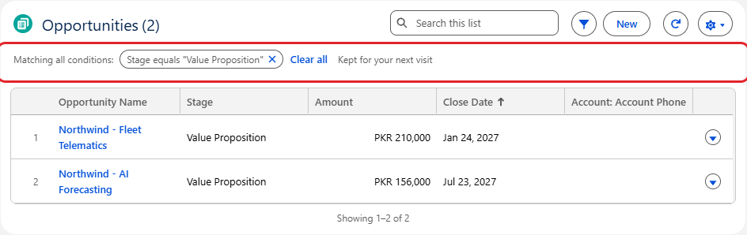

### Sort

Click a column heading to sort the **whole list**, not just the page you are looking at. Click it again to reverse the order. The arrow shows the current sort.

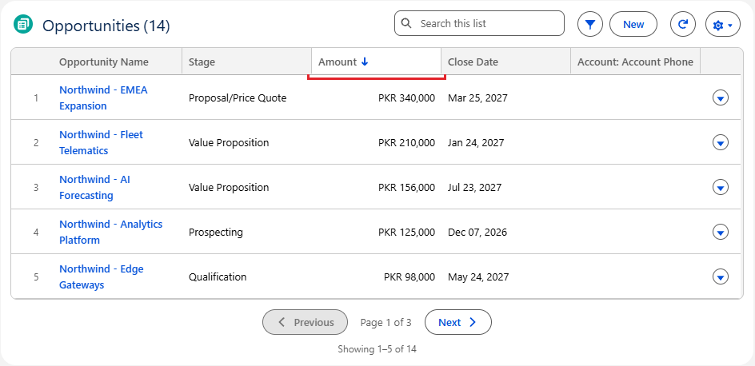

### Pages

Use **Previous** and **Next**. The bottom of the list shows which records you are seeing, for example *Showing 6–10 of 14*.

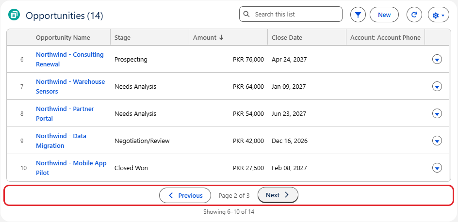

### Buttons in the list header

The header has the buttons your administrator set up, such as **New**, flows and quick actions. Less-used actions are in the **▾** menu at the end of the button group. Header buttons work on the record you are on (here, the Account).

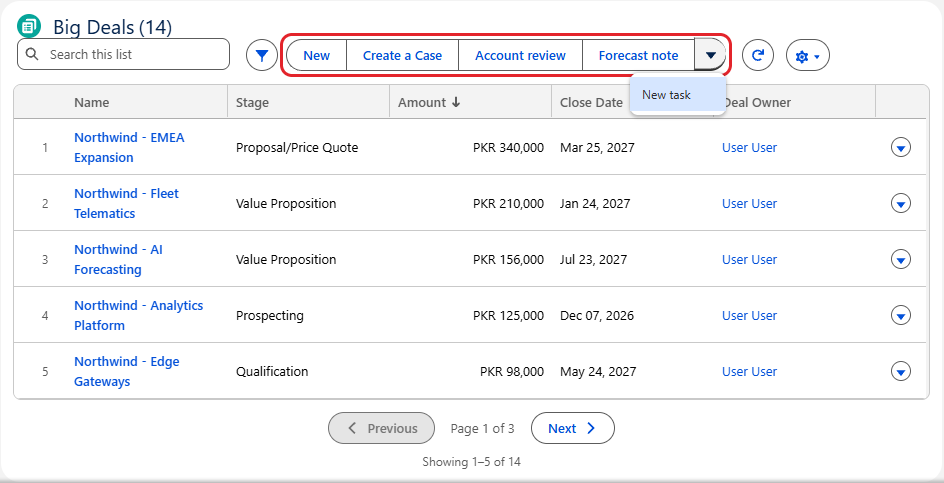

A **flow** opens in a window. Follow its steps and click **Finish**, and the list refreshes by itself.

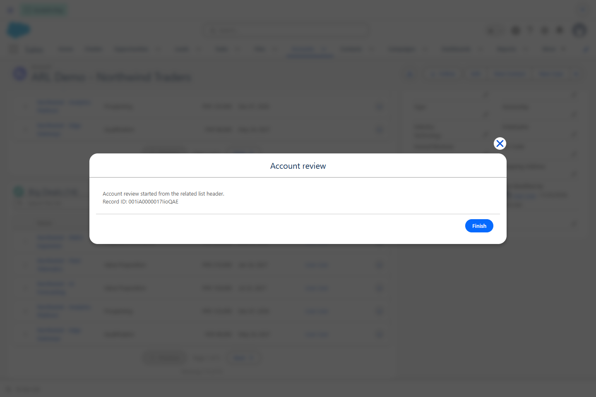

A **quick action** opens Salesforce's own window with the record already filled in, here *Related To = ARL Demo - Northwind Traders*.

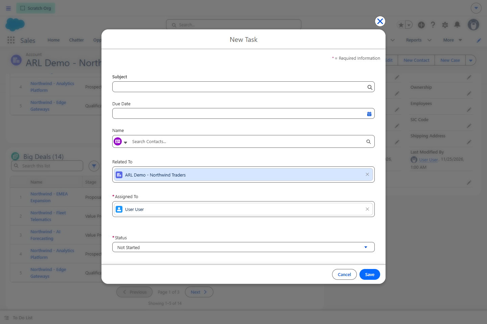

### Row actions

Click **▾** at the end of a row for that record's actions: **View**, **Edit**, **Delete**, and any flows or quick actions your administrator added for rows. These run for that row's record.

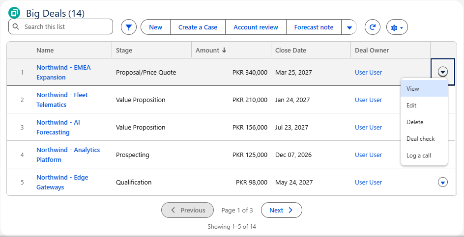

**Edit** opens the standard Salesforce edit form. **Save** saves and refreshes the list; **Cancel** closes it without changes.

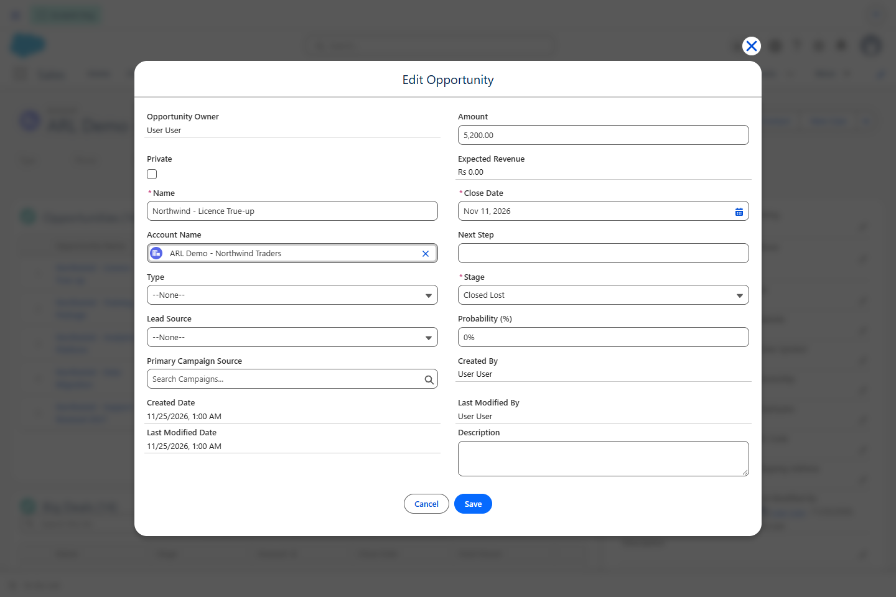

**Delete** always asks first. Click **OK** to delete or **Cancel** to keep the record.

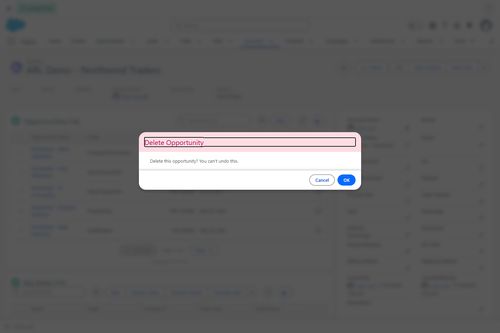

### Deleting several records at once

If your administrator turned it on and you have permission, tick the boxes at the start of the rows and click **Delete selected (n)**. You'll see how many were deleted. Any that couldn't be deleted stay selected, with the reason shown above the list.

### Other things to know

- You only see records and fields you have access to. If a column is hidden for you, the list says so.
- **Refresh** (↻) reloads the list. The list also refreshes after you save an edit, delete a record, or finish a flow or quick action.
- **Settings** (⚙) → *Reset column widths* restores the column widths after you resize them.
- On a phone the list shows as cards, with a **Sort by** choice and the same row actions.

---

## Part 2 — Setting up a list (administrators)

### 1. Install

Install the package (see the main [README](../../README.md#install)), then assign permission sets in **Setup → Permission Sets**:

| Permission set | For |
|---|---|
| **Tekenable Advance Related List User** | Everyone who uses the lists |
| **Tekenable Advance Related List Admin** | Admins who create lists (they also need *Customize Application*) |
| **Tekenable Advance Related List Bulk Delete** | Only users allowed to delete several records at once |

### 2. Open the Tekenable Related List Builder

Open **App Launcher → Tekenable Related List Builder**. Your lists are on the left. Click one to edit it, or click **New related list**.

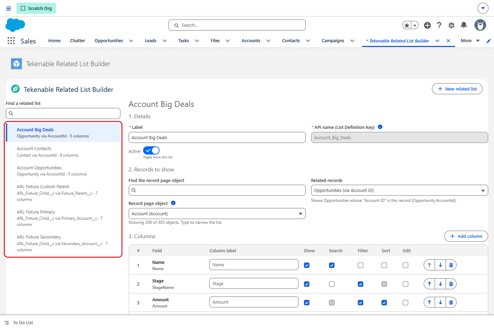

### 3. Choose the records to show

Pick the **record page object** (for example Account), then the **related records** (for example *Opportunities (via Account ID)*). Each option is one relationship, so you never have to type field API names.

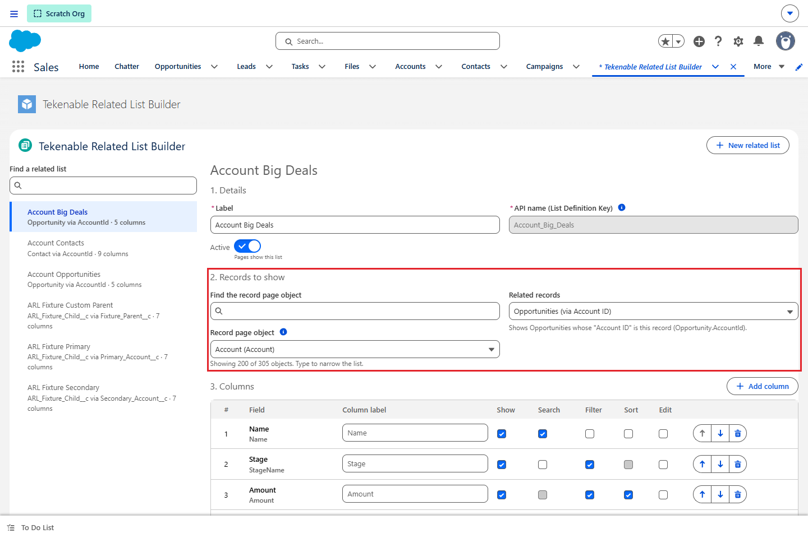

### 4. Choose the columns

Click **Add column** and pick a field. Use **›** to go through a lookup, for example *Account › Industry*. For each column you can:

- change the **label**;
- tick **Show**, **Search**, **Filter**, **Sort** and **Edit**. Options a field type can't support are greyed out, so you can't choose them by mistake;
- reorder with the arrows, or remove with the bin.

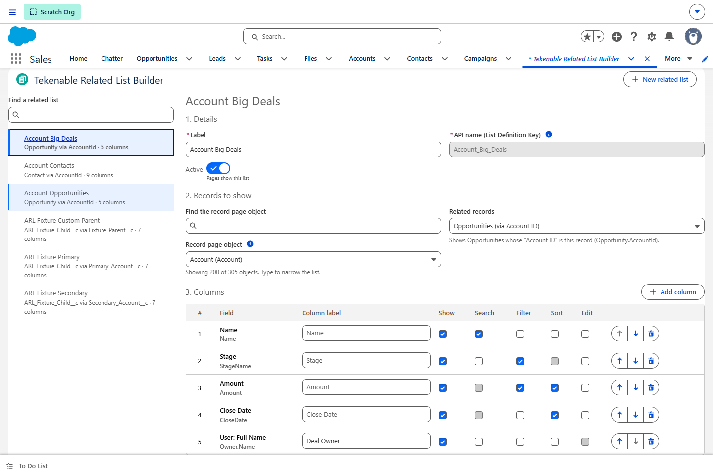
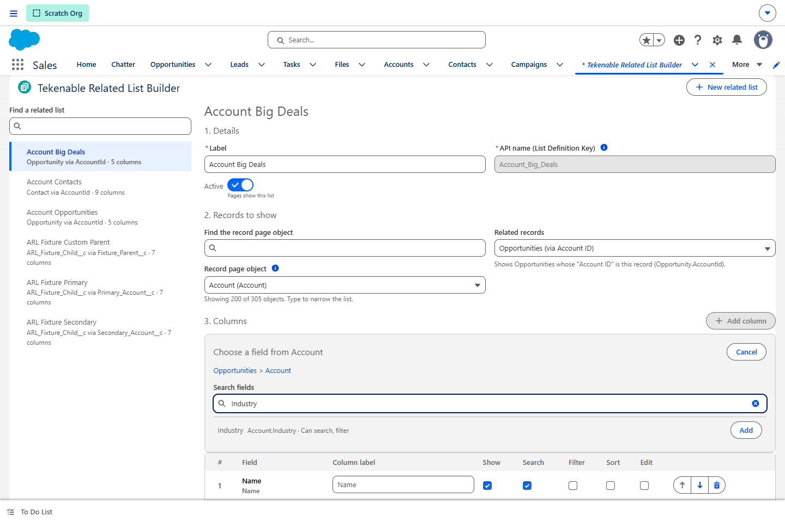

### 5. Choose the default order and row actions

Set **Sort by** and the direction, then tick which row actions are allowed: **Edit**, **Delete** and **Delete selected rows**.

### 6. Buttons and row menu items

This table controls the header buttons exactly:

- **Type:** *Screen flow*, *Quick action*, or *Standard: New button*.
- **Where:** *List header button* (runs for the record page's record) or *Row menu item* (runs for each row's record).
- **Runs:** choose an active flow, or one of the quick actions Salesforce has for that object.
- **Show as:** *Button* or *More menu* (the ▾ menu) for header actions.
- **Order:** the arrows set the left-to-right order in the header, including where **New** appears.
- **Remove:** the bin removes an action. Removing the New row hides the New button.

Flows receive the record ID in a text input variable called `recordId`.

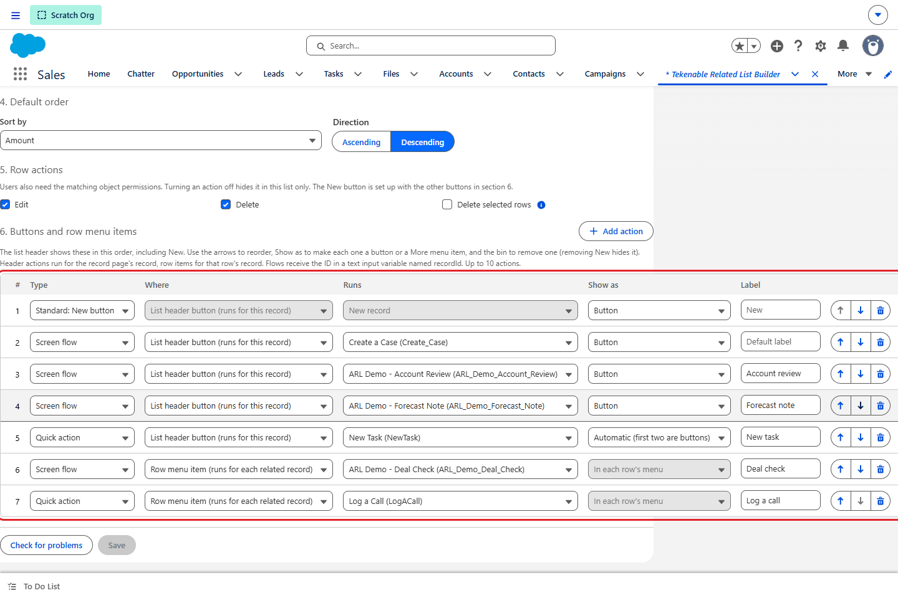

### 7. Check and save

Click **Check for problems**. It uses the same rules the list uses for users. Then click **Save**. It takes a few seconds; the status changes to *Saved.*

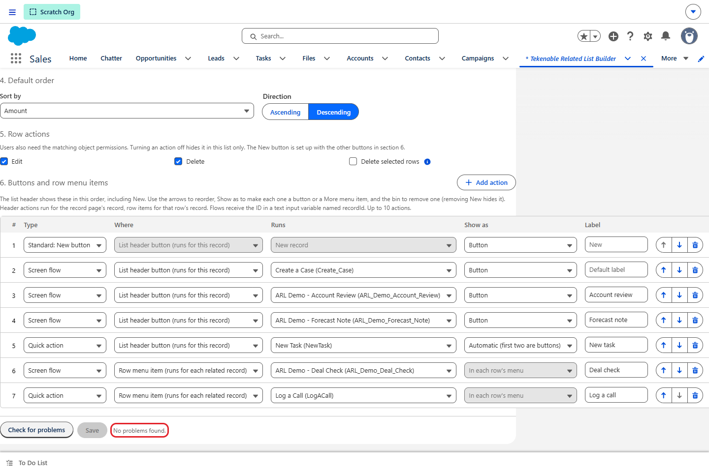

### 8. Put the list on a page

1. Open a record (for example an Account) → **⚙ → Edit Page**.
2. Search the components for **Tekenable** and drag **Tekenable Advance Related List** onto the page.

   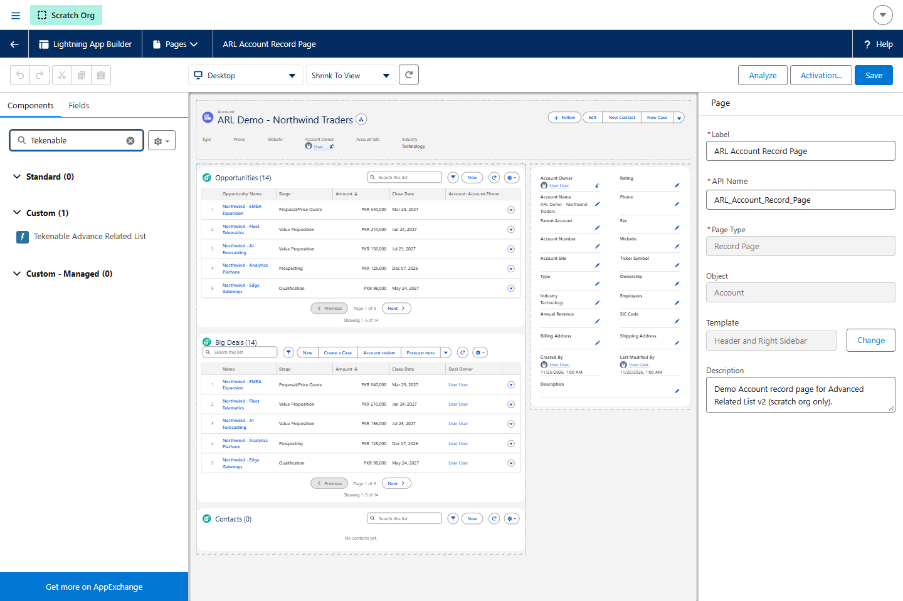

3. In **List Definition Key**, choose your list from the dropdown. It shows only lists made for this object. Optionally set the **List Title**, **Records Per Page**, icon, and **Don't Keep Users' Filters and Sort**.

   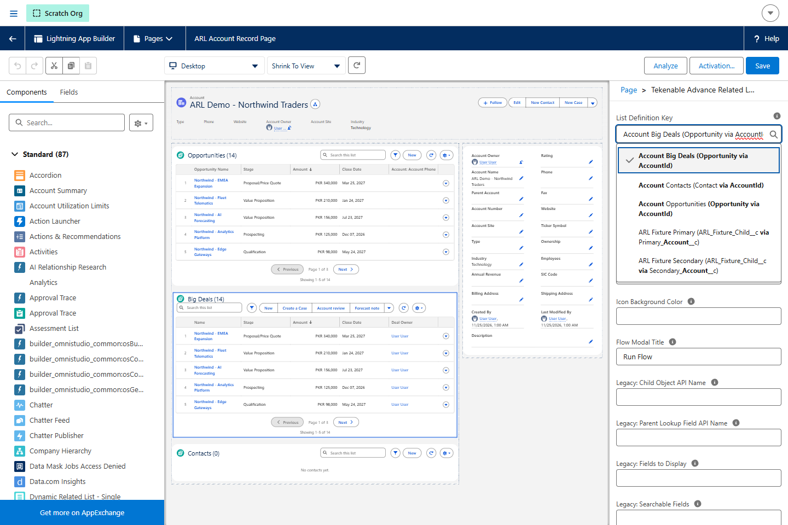

4. Click **Save** and, if it's a new page, **Activation…**.

---

## Questions

| Question | Answer |
|---|---|
| A column I set up is missing for some users | Users only see fields they have field-level access to. The list says when columns are hidden. |
| The New button doesn't show | The user can't create that kind of record, or the New row was removed in the builder (section 6). |
| "This list isn't set up correctly" | The page's List Definition Key points to a list that doesn't exist or is inactive. Choose another in App Builder or activate it in the builder. |
| My filters disappeared | Filters are kept in your browser. Another browser or device, or an admin changing the list, starts fresh. |
| A quick action isn't offered in the builder | Only quick actions Salesforce reports as available for that object are listed (header buttons use the record page object; row items use the related object). |
